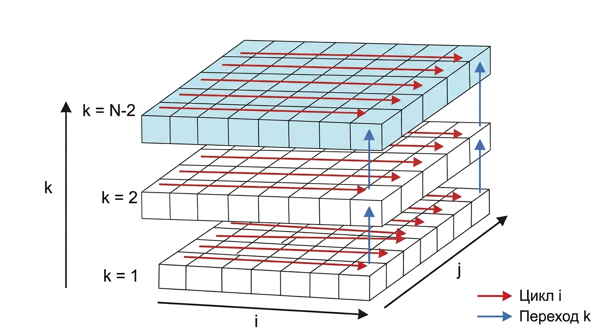
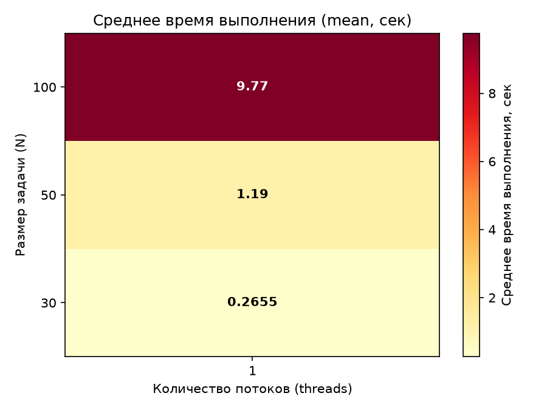
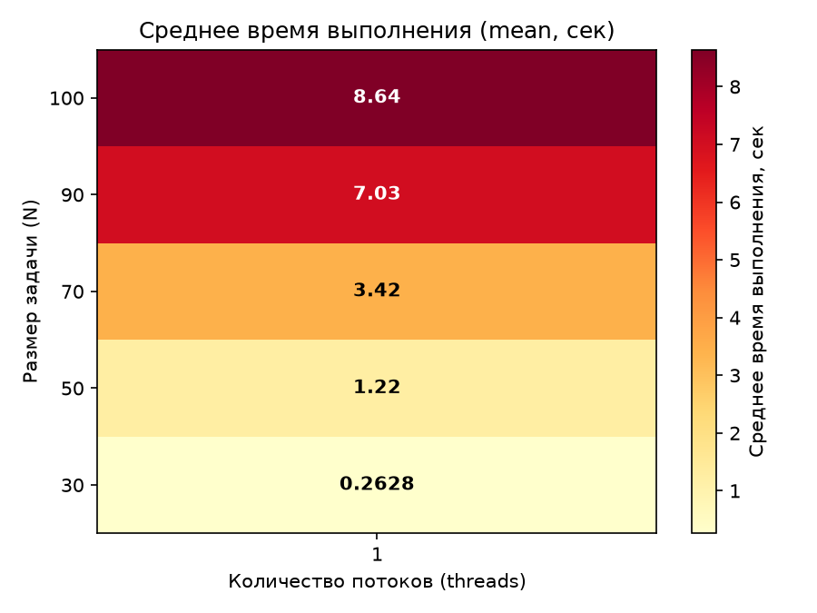

# Parallel program optimization for Polus

I have been puzzled with optimizing program written in c

## Problem statement
Для выполнения практических заданий используются суперкомпьютерные вычислительные ресурсы факультета ВМК.
http://hpc.cs.msu.ru/
В каждой задаче требуется:
1) Для предложенного алгоритма реализовать несколько версий параллельных программ с использованием технологии OpenMP.
a) Вариант параллельной программы с распределением витков циклов при помощи директивы for.
б) Вариант параллельной программы с использованием механизма задач (директива task).
б') Для программ с регулярной зависимостью по данным вместо механизма задач допускается реализация и сравнение различных версий конвейерного выполнения циклов, параллелизм по гиперплоскостям и др.

2) Реализовать параллельную версию программы с использованием технологии MPI.

3) Убедиться в корректности разработанных версий программ.

4) Начальные параметры для задачи должны быть подобраны таким образом, чтобы:
a) Задача помещалась в оперативную память одного узла кластера.
б) Время решения задачи было в примерном диапазоне 5 сек.-15 минут.

5) Исследовать эффективность полученных параллельных программ на суперкомпьютере Polus.
a) Сравнить варианты разработанных версий параллельных программ.
б) Если в процессе распараллеливания программа была существенно оптимизирована/изменена/переписана (например, на С++) необходимо провести сравнение - исходная программа VS программа после преобразований.
в) Исследовать влияние различных опций оптимизации, которые поддерживаются компиляторами (-O2, -O3, -fast...)

6) Исследовать масштабируемость полученной параллельной программы: построить графики зависимости времени выполнения параллельной программы от числа используемых ядер для различного объёма входных данных.
Оптимальным является построение трёхмерного графика: по одной из осей время работы программы, по другой - количество ядер и по третьей - объём входных данных.
Такой график необходимо построить для каждого из разработанных вариантов программы.
Каждый прогон программы с новыми параметрами рекомендуется выполнять несколько раз с последующим усреднением результата (для избавления от случайных выбросов).
Для замера времени рекомендуется использовать функцию omp_get_wtime, общее время работы должно определяться временем работы самой медленной нити/процесса.
Количество ядер/процессоров рекомендуется задавать в виде p=1, 2, 3, 4, 5, 6, 7, 8, 9, 10, 20, 40, 60, 80, 100, 120, 140, 160.

7) Определить основные причины недостаточной масштабируемости программы при максимальном числе используемых ядер/процессоров.

8) Подготовить отчет о выполнении задания, включающий: описание реализованного алгоритма, графики зависимости времени исполнения от числа ядер/процессоров для различного объёма входных данных, текст программы.

P.S. Инструкция по генерации SSH-ключей: https://wiki.cs.msu.ru/Main/SSHKeysManual

# Отчёт.

## Постановка задачи

Представленна программа для вычисления значений в ячейках трёхмерной матрицы. Требуется распараллелить данную программу, провести замеры времени выполнения при разных предоставленных ресурсах (количестве доступных потоков) от размера сходных данных

### Оценка сложности вычислений
Данная программа представляет из себя некоторый вычислительный модуль вычислительная сложность последовательного выполнения которого есть $O(n^3 * T)$, где N - размер измерения матрицы, T - максимальное число иерацию алгоритма. Сложность инициализации матрицы и верификации - $O(n^3)$.

Исследуем потенциальную сложность параллельной программы. Для этого сделаем некоторые предположения. Пусть на машине будет доступно неограниченное количество вычислительных узлов, которые потенциально могут выполнять работу параллельно. Пусть работа разделяется на подзадачи $A_1, A_2, A_3, ... A_n$, вычисления внутри которых могут выполняться параллельно, но подзадачи могут выполняться только друг за другом. Пусть сложность выполнения самой тяжело выполняемого элемента подзадачи $A_i = C_i$, тогда сложностью параллельного алгоритма назовём следующую величину $\sum_{i=1}^nC_i$.

Данная программа состорит из 4 компонентов: инициализация, перебор эпохи, который в себя включает релаксацию, и верификация результата. Оценим сложность параллельных компонентов. Для этого требуется определить подзадачи, которые будут образовываться. В нашем случае требуется определить зависимости по вычислений от данных. Они и будут определять подзадачи.

Рассмотрим инициализацию. Здесь осуществляется обход трехмерного массива, при этом для вычисления данной ячейки $A[i][j][k]$ требуется значение ячейки $A[i - 1][j][k]$. Появляется зависимость по первому измерению. Одновременно может работать $N^2$ процессов, при этом вычисления будут идти слоями по возрастанию $i$. Тогда, если считать, что сложность вычисления одной ячейки $O(1)$, то общая сложность инициализации - $O(n)$.

Рассмотрим блок с релаксацией. В данном фрагменте идёт перезапись 3-х мерного массива, при этом для вычисления данной ячейки требуется информация о всех её соседях 6-ти соседях. Стоит заметить, что данная реализация использует уже переписанные значения массива уже в данной эпохе. Давайте разберём сложность данного фрагмента и при условии, что это желанное поведение и при условии, что предполагалось использовать значения предыдущего слоя.

|  |  |
| :---: | :---: |
| *Рис. 1. Порядок обхода массива* | *Рис. 2. Зависимость по данным* |

Если рассматривать, что данное поведение является желательным, то мы обязаны выполнять вычисления по гиперплоскостям, определяемых уравнением в целых числах $i + j + k = L$ с увеличением по L. В таком случае мы будет вынуждены выполнить вычисление порядка 3*N слоев. Из неприятных последствий такого типа вычислений можно отметить варьирующиеся количество работы на разных слоях: в начале будет наблюдаться голодание потоков (будет мало работы), затем будет квадратичный рост фронта работ (stars and bars)

$$i,j,k \in \mathbb{Z_+}: i + j + k = L$$
$$T = {L + 2 \choose 2} = \frac{(L + 2)(L + 1)}{2}$$

потом уменьшение скорости роста темпов работы, а затем вновь квадратичный спад. Будет достаточно много времени простоя ресурсов. Однако, можно вспомнить, что требуется обрабатывать несколько поколений. В данной схеме это можно выполнять параллельно с подсчётом старых поколений. После подсчёта данного слоя $L$ поколения $G$ будут подготовлены данные для вычисления слоя $L-1$ поколения $G-1$. Таким образом мы получим голодание потоков только в начале первого поколения. В такой схеме, количество работы с подсчётов каждого слоя первого поколения будет рости кубически:

$$\sum_{m = 0}^L{m + 2 \choose 2} = {L + 3 \choose 3} = \frac{(L + 1)(L + 2)(L + 3)}{3}$$

Пояснение к формуле: данное выражение эквивалентно выбору 3 элементов из множества L + 3 элементов. Проделаем следующие умозаключения. Фиксируем максимальный из выбранных элементов, остальные выбираем из меньших оставшихся.

Тогда одновременно в некоторый момент времени может вычислятся $3N$ слоёв, максимальное теоритически возможное число одновременно работающих потоков - $N^3$. Здесь стоит сделать оговорку: в реальной жизни слои с меньшим количеством работы будет выполнятся быстрее и оставлять зазоры из работы, которая не может быть посчитана из-за того, что более большие слои не успеют выполнится. Поэтому пространство больших часто будет оставаться без работников.

Отдельной проблемой остаётся вопрос о том, когда остановить вычисления. Возможно, стоит аккумулировать редуцировать переменную eps по поколениям. При достижении нужного eps больше не порождать новые поколения, досчитывать оставшиеся, потом возвращать ответ. Это можно делать только при условии сходимости данного алгоритма. Если нет гарантии, что при увеличении поколения мы будет не ухудшать ответ, то данную стратегию применять нельзя. Мы верим в сходимость данного алгоритма, поэтому можем применить данную технику.

Рассмотрим случай, когда требовались значения A, полученные только на прошлом поколении (это может негативно повлиять на сходимость алгоритма, потому что мы изменим логику изначальной программы). В таком случае требуется хранить дополнительную матрицу прошлого поколения, одновременно поколение может обрабатывать $N^3$ потоков. Тогда сложность данного алгоритма (степень параллельности) $O(T)$, где $T$ - число поколений. Данный подход потребудет удвоения используемой памяти минимум вдвое, что может уже при $N=500$ привести к потреблению минимум 1.86 GB.

## Ход работы

В данном пункте будет сравнение времени выполнения программы, полученной на данном этапе, программы, полученной на предыдущем этапе и исходной однопоточной версией. Для обображения эффективности были использованы температурные карты.

### Простая оптимизация параллельной программы (simple-optimize)

При изучении исходного кода программы были замечены следующие недостатки:

- при инициализации массива создаётся отдельный массив `int Active[N][N][N]`, который хранит просто логические значения, вычисляемое значение никак не зависит от контекста программы, массив заполняется только в init, а затем просто используется. Это дополнительный накладные расходы на память и на время обращение к памяти, которая в данным момент может быть в другом процессе (с оглядкой на будущее). Было принято решение обернуть это в `inline` функцию, чтобы обеспечить вычисление «налету». Тем самым мы подсказываем компилятору не создавать функцию, а вшить её код прямо в программу.

- заметили, что раскладка массива в памяти не соответствует порядку его обхода. Это повышает вероятность попаданий в кеш, тем самым замедляя программу. Было решено изменять порядок раскладки измерений в массиве. Было `A[i][j][k]`, стало `A[k][j][i]`. Вероятно, в дальнейшем придётся менять раскладку в массиве на раскладку по гиперплоскостям, чтобы увеличить эффективность использования кеша.

Далее приведены сравнение времени выполнения исходной и модифицированной программы.

|  |  |
| :---: | :---: |
| *Рис. 3. Время выполнения базовой версии* | *Рис. 4. Время выполнения кеш-оптимизированной версии* |

Из графика заметено ускорение программы на одну секунду в случае $N=100$. Есть предположение, что столь несущественный прирост обусловлен слишком сложной зависимостью данных, которая мешает оптимальной работе кеша. Возможно, оптимальным решением будет поменять раскладку массива по гиперплоскостям.